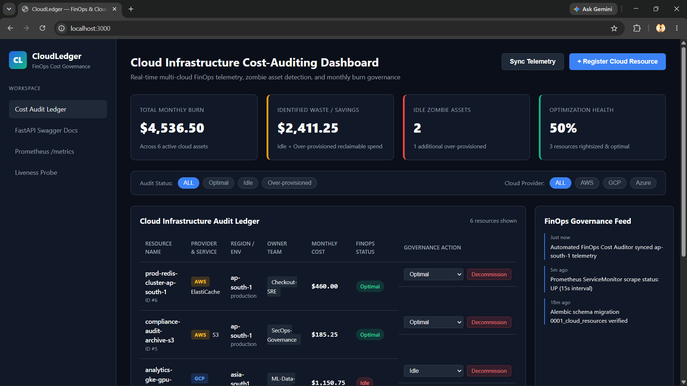
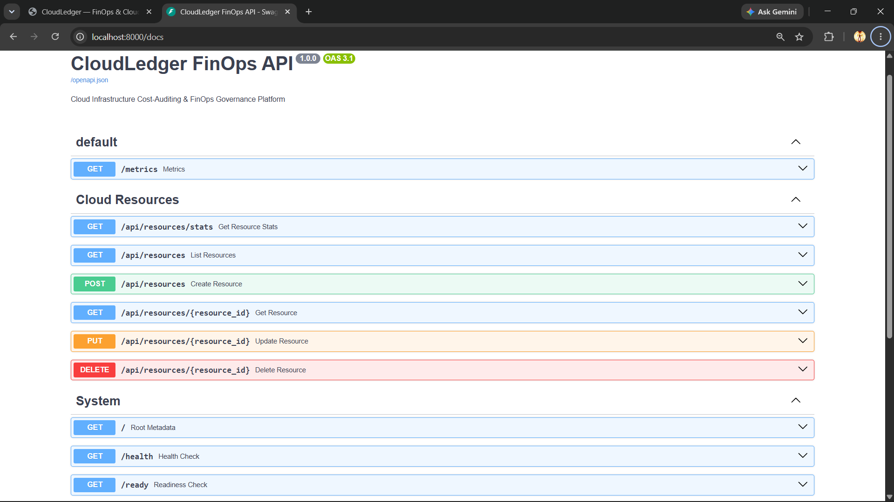

# Module 1 (M1) — Application: Frontend + Backend + Database (10 Points)

## 1. Module Header & Point Breakdown

| Grading Criterion | Max Points | Implementation Status |
| :--- | :---: | :--- |
| FastAPI backend starts and responds to `/health` | 2 pts | Completed (`GET /health` & `GET /ready` in `backend/app/main.py`) |
| Minimum 4 REST API endpoints implemented (`GET`, `POST`, `PUT`, `DELETE`) | 3 pts | Completed (6 REST endpoints in `backend/app/routes.py`) |
| PostgreSQL database with at least one table managed by Alembic migrations | 2 pts | Completed (`cloud_resources` table & `0001_create_cloud_resources.py`) |
| React/HTML frontend renders and makes API calls | 2 pts | Completed (React + Vite FinOps Dashboard calling `/api/resources` & `/api/resources/stats`) |
| Responsive and usable UI, not a blank page | 1 pt | Completed (4 FinOps KPI cards, interactive filter bar, resource table, and audit modal) |
| **Total** | **10 pts** | **10 / 10** |

---

## 2. Files Submitted in This Module

- [x] `backend/app/__init__.py`
- [x] `backend/app/database.py`
- [x] `backend/app/models.py`
- [x] `backend/app/schemas.py`
- [x] `backend/app/routes.py`
- [x] `backend/app/main.py`
- [x] `backend/alembic.ini`
- [x] `backend/alembic/env.py`
- [x] `backend/alembic/script.py.mako`
- [x] `backend/alembic/versions/0001_create_cloud_resources.py`
- [x] `backend/requirements.txt`
- [x] `frontend/package.json`
- [x] `frontend/vite.config.js`
- [x] `frontend/index.html`
- [x] `frontend/src/main.jsx`
- [x] `frontend/src/App.jsx`
- [x] `frontend/src/App.css`
- [x] `docker-compose.yml`

---

## 3. Step-by-Step Verification Commands

Run these commands in Phase 2 to verify the full application stack:

```bash
# 1. Build and launch PostgreSQL, FastAPI Backend, and React/Nginx Frontend
docker compose up --build -d

# 2. Verify all three containers are running and healthy
docker compose ps

# 3. Verify FastAPI health and readiness probes
curl -i http://localhost:8000/health
curl -i http://localhost:8000/ready

# 4. Verify FinOps KPI stats and seeded cloud resources
curl -s http://localhost:8000/api/resources/stats | python3 -m json.tool
curl -s http://localhost:8000/api/resources | python3 -m json.tool

# 5. Test POST, PUT, and DELETE REST operations
curl -s -X POST http://localhost:8000/api/resources \
  -H "Content-Type: application/json" \
  -d '{
    "resource_name": "prod-kafka-msk-ap-south-1",
    "provider": "AWS",
    "service_type": "MSK",
    "region": "ap-south-1",
    "environment": "production",
    "monthly_cost": 640.00,
    "status": "Optimal",
    "owner_team": "Data-Streaming"
  }' | python3 -m json.tool
```

---

## 4. Screenshot & Evidence Placeholders

### Screenshot 1: Running CloudLedger FinOps Dashboard in Browser

*Capture Instructions:* Open `http://localhost:3000` in your browser. Ensure the URL bar (`localhost:3000`), the 4 KPI summary cards (Total Monthly Burn, Identified Waste / Savings, Idle Zombie Assets, Optimization Health %), and the populated Cloud Infrastructure Audit Ledger table with the 5 auto-seeded resources are clearly visible.

### Screenshot 2: FastAPI `/docs` Swagger UI & `/health` Endpoint

*Capture Instructions:* Open `http://localhost:8000/docs` in your browser showing all `GET`, `POST`, `PUT`, and `DELETE` endpoints under `Cloud Resources` and `System`.

---

## 5. Written Explanations / Submission Notes

**Domain Architecture Statement:**
CloudLedger is a custom FinOps & Cloud Infrastructure Cost-Auditing SaaS platform designed to track multi-cloud (`AWS`, `GCP`, `Azure`) infrastructure spend, flag idle or over-provisioned zombie assets, and calculate real-time cost-optimization health across engineering teams. Unlike a generic task board, CloudLedger models cloud resource telemetry (`resource_name`, `provider`, `service_type`, `region`, `environment`, `monthly_cost`, `status`, and `owner_team`) stored in PostgreSQL (`cloud_resources` table) managed via Alembic migrations (`0001_create_cloud_resources.py`) and exposes real-time FinOps aggregation via `GET /api/resources/stats`.