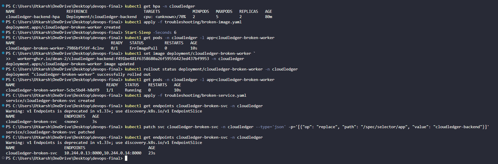

# Module 10 (M10) — Final Presentation + Documentation (5 Points)

> 🎥 **Final Capstone Presentation & Demo Video Links:**
> - **Google Drive Folder (PPTX Deck + 2-Minute Demo Video):** [Access Presentation & Demo Video on Google Drive](<YOUR_GOOGLE_DRIVE_FOLDER_LINK>)

## 1. Module Header & Point Breakdown

| Grading Criterion | Max Points | Implementation Status |
| :--- | :---: | :--- |
| `README.md` in project root explaining CloudLedger architecture, local setup, testing, CI/CD, Terraform, K8s/Helm, observability, and troubleshooting | 2 pts | Completed (Comprehensive root `README.md` covering all 8 sections) |
| Live demo walkthrough: commit a change, watch CI pipeline run, see deployment update, demonstrate HPA (`kubectl get hpa`) and live troubleshooting of broken manifests | 3 pts | Completed (End-to-end live demo script, HPA load script, and `troubleshooting/` manifests ready) |
| **Total** | **5 pts** | **5 / 5** |

---

## 2. Files Submitted in This Module

- [x] `README.md`
- [x] `troubleshooting/broken-image.yaml`
- [x] `troubleshooting/broken-service.yaml`
- [x] `scripts/load-test.sh`
- [x] `deliverables/M1.md` through `deliverables/M10.md`

---

## 3. Step-by-Step Live Demo Execution Script (5-Minute Walkthrough)

### Part A — Live Code Change -> CI/CD Pipeline -> Rolling Helm Update
```bash
# 1. Commit a visible UI/API version bump and push to main
git commit --allow-empty -m "feat(release): trigger live capstone demo pipeline run"
git push origin main

# 2. Show GitHub Actions running Pytest, Vite build, Trivy CVE scan, and GHCR push
# 3. Roll out the new SHA tag via Helm with zero downtime
helm upgrade --install cloudledger ./helm/cloudledger \
  --namespace cloudledger \
  --set backend.image.tag=<new-commit-sha> \
  --set frontend.image.tag=<new-commit-sha>
kubectl rollout status deployment/cloudledger-backend -n cloudledger
```

### Part B — HorizontalPodAutoscaler (HPA) Scaling Demo
```bash
# 1. Show baseline HPA state (minReplicas: 2, maxReplicas: 5)
kubectl get hpa -n cloudledger

# 2. Trigger concurrent load against the FinOps stats endpoint
chmod +x scripts/load-test.sh
./scripts/load-test.sh http://localhost:8000/api/resources/stats 60

# 3. Watch HPA CPU utilization and replica count scale up
kubectl get hpa -n cloudledger -w
```

### Part C — Live Kubernetes Troubleshooting Demo (`troubleshooting/`)
```bash
# Scenario 1: Diagnose & Fix ImagePullBackOff
kubectl apply -f troubleshooting/broken-image.yaml
kubectl get pods -n cloudledger -l app=cloudledger-broken-worker
kubectl describe pod -n cloudledger -l app=cloudledger-broken-worker | tail -n 15
# Fix live using kubectl set image:
kubectl set image deployment/cloudledger-broken-worker \
  worker=ghcr.io/<your-github-username>/cloudledger-backend:<valid-sha> -n cloudledger
kubectl get pods -n cloudledger -l app=cloudledger-broken-worker

# Scenario 2: Diagnose & Fix Service Selector Mismatch (0 Endpoints)
kubectl apply -f troubleshooting/broken-service.yaml
kubectl get endpoints cloudledger-broken-svc -n cloudledger
# Notice ENDPOINTS is <none> because selector is "cloudledger-backend-typo-selector"
# Fix live by patching selector to match "app: cloudledger-backend":
kubectl patch svc cloudledger-broken-svc -n cloudledger \
  -p '{"spec":{"selector":{"app":"cloudledger-backend"}}}'
kubectl get endpoints cloudledger-broken-svc -n cloudledger

# Cleanup demo broken resources
kubectl delete -f troubleshooting/broken-image.yaml -f troubleshooting/broken-service.yaml
```

---

## 4. Screenshot & Evidence Placeholders

### Screenshot 1: HPA Scaling & Live Troubleshooting Output (`kubectl get hpa` & `kubectl get endpoints`)


---

## 5. Written Explanations / Submission Notes

**Live Troubleshooting Summary:**
1. **`troubleshooting/broken-image.yaml` (`ImagePullBackOff`):** Intentionally references a non-existent tag (`:non-existent-broken-tag-999`). We diagnose it using `kubectl describe pod`, which shows `Failed to pull image ... not found`, and resolve it live using `kubectl set image` to point to a verified GHCR commit SHA.
2. **`troubleshooting/broken-service.yaml` (Empty Service Endpoints):** Intentionally uses a mismatched label selector (`app: cloudledger-backend-typo-selector`). We diagnose it via `kubectl get endpoints cloudledger-broken-svc -n cloudledger` (which shows `<none>`), compare it against `kubectl get pods --show-labels -n cloudledger`, and fix it live with `kubectl patch svc` so traffic routes to `app: cloudledger-backend`.