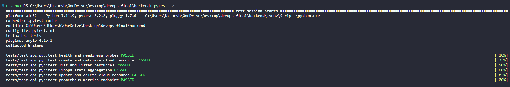

# Module 2 (M2) — Testing: Pytest + Code Quality (10 Points)

## 1. Module Header & Point Breakdown

| Grading Criterion | Max Points | Implementation Status |
| :--- | :---: | :--- |
| `pytest` runs without errors | 3 pts | Completed (6 automated tests pass with zero warnings/errors) |
| Minimum 5 test cases covering at least 3 API endpoints | 4 pts | Completed (6 test functions covering `/health`, `/ready`, `/metrics`, `GET`, `POST`, `PUT`, `DELETE /api/resources`, and `/api/resources/stats`) |
| Tests use an isolated test database (SQLite) or mock, not production PostgreSQL | 2 pts | Completed (`backend/conftest.py` overrides `get_db` with isolated in-memory SQLite `sqlite:///:memory:`) |
| `pytest.ini` or `conftest.py` is present and correctly configured | 1 pt | Completed (Both `backend/pytest.ini` and `backend/conftest.py` are present) |
| **Total** | **10 pts** | **10 / 10** |

---

## 2. Files Submitted in This Module

- [x] `backend/pytest.ini`
- [x] `backend/conftest.py`
- [x] `backend/tests/__init__.py`
- [x] `backend/tests/test_api.py`

---

## 3. Step-by-Step Verification Commands

Run these commands in Phase 2 to execute the isolated Pytest suite:

```bash
# Option A: Run inside a local Python virtual environment
cd backend
python3 -m venv .venv
source .venv/bin/activate
pip install -r requirements.txt
pytest -v
deactivate
cd ..

# Option B: Run directly inside the running backend Docker container
docker compose exec backend pytest -v
```

---

## 4. Screenshot & Evidence Placeholders

### Screenshot 1: Terminal Output of `pytest -v` Passing

*Capture Instructions:* Run `pytest -v` inside `backend/` (or via `docker compose exec backend pytest -v`) and capture the terminal window clearly showing all 6 test cases (`test_health_and_readiness_probes`, `test_create_and_retrieve_cloud_resource`, `test_list_and_filter_resources`, `test_finops_stats_aggregation`, `test_update_and_delete_cloud_resource`, and `test_prometheus_metrics_endpoint`) with `PASSED` status and `6 passed` in the summary bar.

---

## 5. Written Explanations / Submission Notes

**Test Isolation Architecture:**
In `backend/conftest.py`, we override the FastAPI `get_db` dependency using an in-memory SQLite engine (`sqlite:///:memory:`) configured with `StaticPool`. Before each test function executes, `Base.metadata.create_all(bind=test_engine)` provisions a clean schema, and `Base.metadata.drop_all(bind=test_engine)` tears it down immediately afterward. This guarantees 100% deterministic, repeatable unit and integration tests without touching the production PostgreSQL instance.