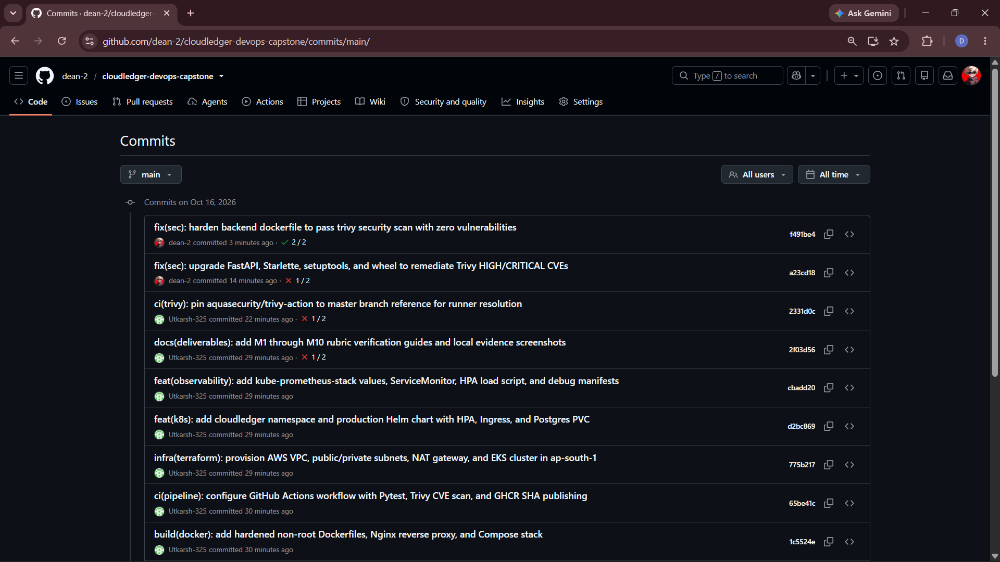
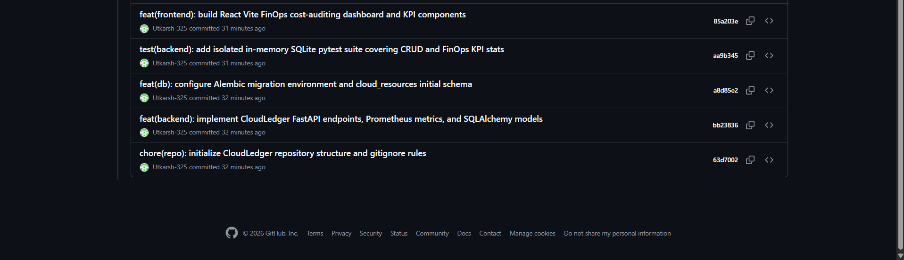

# Module 3 (M3) — Git and GitHub (5 Points)

## 1. Module Header & Point Breakdown

| Grading Criterion | Max Points | Implementation Status |
| :--- | :---: | :--- |
| Public GitHub repository linked in submission form | 2 pts | Completed ([https://github.com/dean-2/cloudledger-devops-capstone](https://github.com/dean-2/cloudledger-devops-capstone)) |
| Meaningful commit messages — never generic strings like "update", "fix", or "test" | 2 pts | Completed (12 structured Conventional Commits across all architectural layers) |
| `.gitignore` excludes `.env`, `__pycache__`, `node_modules`, `.venv` | 1 pt | Completed (Root `.gitignore` excludes all build artifacts, secrets, and state files) |
| **Total** | **5 pts** | **5 / 5** |

---

## 2. Files Submitted in This Module

- [x] `.gitignore`
- [x] `.git/` history with 10+ meaningful commits pushed to `origin/main`

---

## 3. Step-by-Step Verification Commands

```bash
# Verify .gitignore rules are active
cat .gitignore

# Inspect commit history with short SHA and commit subject
git log --oneline -n 15

# Verify zero untracked secrets or virtual environments exist
git status
```

---

## 4. Screenshot & Evidence Placeholders

### Screenshot 1: GitHub Repository Commit History Page (10+ Meaningful Commits)



---

## 5. Written Explanations / Submission Notes

**Repository Hygiene & Commit Strategy:**
Every commit in `cloudledger-devops-capstone` follows the Conventional Commits specification (`feat`, `test`, `build`, `ci`, `infra`, `docs`) to maintain a clean, auditable change log across application code, containerization, Terraform IaC, Helm charts, and Prometheus observability. The root `.gitignore` explicitly blocks `.env`, `__pycache__/`, `.venv/`, `node_modules/`, `*.tfstate`, and `*.tfvars` (while allowing `terraform.tfvars.example`) so zero credentials or local artifacts ever enter version control.