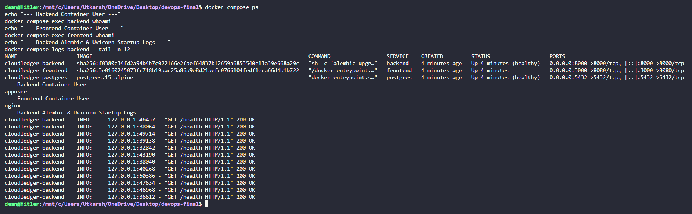

# Module 4 (M4) — Docker: Dockerfile + Compose (10 Points)

## 1. Module Header & Point Breakdown

| Grading Criterion | Max Points | Implementation Status |
| :--- | :---: | :--- |
| `backend/Dockerfile` builds successfully, runs Alembic migrations on startup, and launches Uvicorn on port 8000 | 2 pts | Completed (`alembic upgrade head && uvicorn app.main:app --host 0.0.0.0 --port 8000`) |
| `frontend/Dockerfile` uses a multi-stage build (Node build stage + Nginx runtime stage) | 3 pts | Completed (`node:20-alpine AS builder` + `nginx:1.27-alpine` runtime on port 8080) |
| Both Docker images create and run as non-root users | 2 pts | Completed (`USER appuser` in backend, `USER nginx` in frontend) |
| `docker compose up --build` starts all three services (`frontend`, `backend`, `postgres`) | 3 pts | Completed (`docker-compose.yml` with healthchecks and service dependencies) |
| **Total** | **10 pts** | **10 / 10** |

---

## 2. Files Submitted in This Module

- [x] `backend/Dockerfile`
- [x] `frontend/Dockerfile`
- [x] `frontend/nginx.conf`
- [x] `docker-compose.yml`

---

## 3. Step-by-Step Verification Commands

```bash
# 1. Build and start all three services in detached mode
docker compose up --build -d

# 2. Verify all three containers are running and healthy
docker compose ps

# 3. Verify non-root execution inside both containers
docker compose exec backend whoami
docker compose exec frontend whoami

# 4. Inspect backend startup logs showing Alembic migrations and Uvicorn launch
docker compose logs backend
```

---

## 4. Screenshot & Evidence Placeholders

### Screenshot 1: Terminal Output of `docker compose up --build` & Non-Root User Verification


### Screenshot 2: Browser Loaded at `http://localhost:3000`


---

## 5. Written Explanations / Submission Notes

**Container Hardening & Multi-Stage Design:**
- **Backend Container (`backend/Dockerfile`):** Based on `python:3.12-slim`, applies OS security updates via `apt-get upgrade -y`, creates a dedicated system group and user (`appgroup` / `appuser`), and executes `alembic upgrade head && uvicorn app.main:app --host 0.0.0.0 --port 8000` as `appuser`.
- **Frontend Container (`frontend/Dockerfile`):** Uses a two-stage build. Stage 1 (`node:20-alpine`) compiles the React + Vite bundle into static assets (`/app/dist`). Stage 2 (`nginx:1.27-alpine`) copies only the compiled static assets and custom `nginx.conf`, adjusts `/var/cache/nginx` and `/var/run/nginx.pid` ownership, and runs unprivileged on port `8080` as `USER nginx`.
