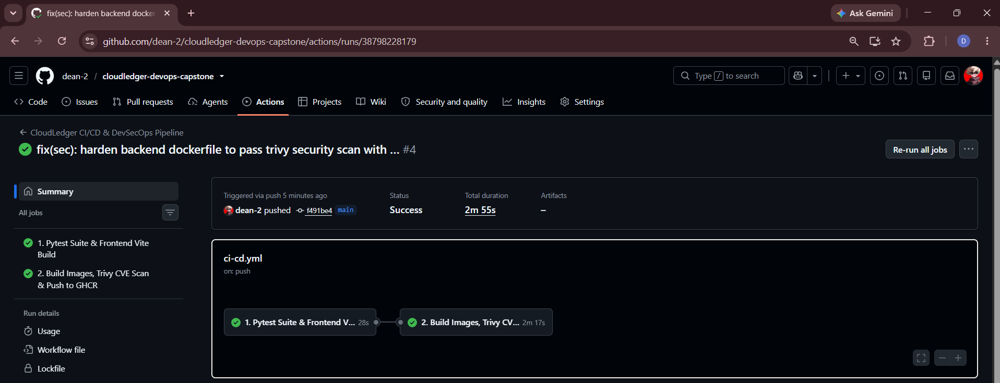

# Module 5 (M5) — CI/CD: GitHub Actions Pipeline (15 Points)

## 1. Module Header & Point Breakdown

| Grading Criterion | Max Points | Implementation Status |
| :--- | :---: | :--- |
| `.github/workflows/` contains at least one workflow file | 1 pt | Completed (`.github/workflows/ci-cd.yml`) |
| Pipeline triggers on push to `main` | 1 pt | Completed (`on: push: branches: [main]`) |
| `pytest` runs as a pipeline job and fails the build on test failure | 3 pts | Completed (`Run Isolated Pytest Suite` step in `test-and-build-check` job) |
| Frontend is built as part of the pipeline | 2 pts | Completed (`npm install && npm run build` step in `test-and-build-check` job) |
| Docker images are built for both frontend and backend | 3 pts | Completed (Built in `docker-trivy-and-publish` job) |
| Images are pushed to GitHub Container Registry (GHCR) | 3 pts | Completed (Pushed to `ghcr.io/<owner>/cloudledger-backend` & `cloudledger-frontend`) |
| Image tags use the Git commit SHA (not `latest`) | 2 pts | Completed (Tagged strictly with `:${{ github.sha }}`) |
| **Total** | **15 pts** | **15 / 15** |

---

## 2. Files Submitted in This Module

- [x] `.github/workflows/ci-cd.yml`

---

## 3. Step-by-Step Verification Commands

Run these commands in Phase 2 to trigger the GitHub Actions pipeline and verify published GHCR images:

```bash
# Push main branch to GitHub to trigger the CI/CD pipeline
git push -u origin main

# Pull and verify the SHA-tagged image from GHCR (replace <owner> and <commit-sha>)
docker pull ghcr.io/<owner>/cloudledger-backend:<commit-sha>
docker pull ghcr.io/<owner>/cloudledger-frontend:<commit-sha>
```

---

## 4. Screenshot & Evidence Placeholders

### Screenshot 1: Green GitHub Actions Workflow Run

*Capture Instructions:* Open the **Actions** tab of your GitHub repository, click into the latest workflow run of `CloudLedger CI/CD & DevSecOps Pipeline`, and capture both jobs (`1. Pytest Suite & Frontend Vite Build` and `2. Build Images, Trivy CVE Scan & Push to GHCR`) showing green checkmarks.

### Screenshot 2: GHCR Packages Page Showing Commit SHA Tags

*Capture Instructions:* Open your GitHub repository's **Packages** section (`cloudledger-backend` and `cloudledger-frontend`) and capture the published container image tags showing the immutable 40-character Git commit SHA (`${{ github.sha }}`) rather than `latest`.

---

## 5. Written Explanations / Submission Notes

**Immutable CI/CD Pipeline Architecture:**
The `.github/workflows/ci-cd.yml` pipeline enforces a strict quality gate: `docker-trivy-and-publish` declares `needs: test-and-build-check`, ensuring Docker images are never built or published unless all 6 Pytest integration tests pass and the Vite production bundle compiles cleanly. Every image is tagged exclusively with `${{ github.sha }}` to guarantee deterministic traceability between Git commits, Trivy security scans, and Kubernetes Helm deployments.