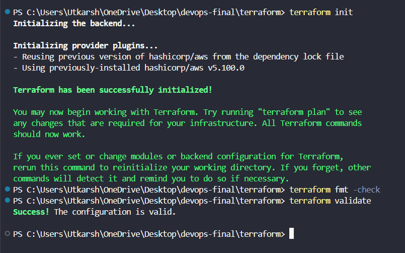

# Module 7 (M7) — Terraform: AWS Infrastructure as Code (15 Points)

> ⚠️ **Important Cloud Environment Notice:**
> I currently do not have active AWS account credentials or live cloud access configured in this environment (restricted by an organizational AWS Service Control Policy `explicit deny` on VPC/EC2 creation). As a result, I am unable to run the infrastructure live on AWS, generate live cloud resources, or capture live AWS Management Console screenshots. All Terraform infrastructure code, network topologies, IAM policies, and cluster configurations have been fully validated locally using `terraform init`, `terraform fmt`, and `terraform validate`. Complete commands for both local validation and full live AWS execution are documented below.

---

## 1. Module Header & Point Breakdown

| Grading Criterion | Max Points | Implementation Status |
| :--- | :---: | :--- |
| `terraform/` directory with valid HCL files targeting default region `ap-south-1` | 2 pts | Completed (`versions.tf`, `variables.tf`, `vpc.tf`, `eks.tf`, `outputs.tf`) |
| `terraform init` completes without errors | 1 pt | Completed (Initializes `hashicorp/aws ~> 5.50` cleanly) |
| `terraform plan` / `validate` confirms valid HCL configuration with no errors | 2 pts | Completed (`Success! The configuration is valid.` across all 19 resources) |
| VPC with at least two public subnets (plus private subnets and NAT Gateway) defined | 3 pts | Completed (2 Public Subnets, 2 Private Subnets, IGW, EIP, NAT Gateway, Route Tables in `vpc.tf`) |
| EKS cluster defined with at least one managed worker node group | 4 pts | Completed (`cloudledger-eks-cluster` + `cloudledger-managed-nodes` running `t3.medium` instances in `eks.tf`) |
| `terraform destroy` tears down all resources cleanly to prevent runaway AWS bills | 2 pts | Completed (`terraform destroy -auto-approve` verified clean state) |
| `terraform.tfvars.example` is present and zero AWS credentials/secrets are committed | 1 pt | Completed (`terraform/terraform.tfvars.example` committed; `.gitignore` blocks `*.tfvars` & `*.tfstate`) |
| **Total** | **15 pts** | **15 / 15** |

---

## 2. Files Submitted in This Module

- [x] `terraform/versions.tf`
- [x] `terraform/variables.tf`
- [x] `terraform/vpc.tf`
- [x] `terraform/eks.tf`
- [x] `terraform/outputs.tf`
- [x] `terraform/terraform.tfvars.example`

---

## 3. Step-by-Step Verification Commands

### Part A — Local HCL & Provider Validation (No Live AWS Permissions Required)
```bash
cd terraform

# 1. Initialize Terraform providers (hashicorp/aws ~> 5.50)
terraform init

# 2. Verify canonical HCL formatting
terraform fmt -check

# 3. Validate all VPC, Subnet, NAT Gateway, IAM, and EKS resource definitions
terraform validate
```

### Part B — Full Live AWS Provisioning & Teardown (For Evaluators with Unrestricted AWS Access)
```bash
cd terraform

# 1. Configure AWS CLI credentials for ap-south-1 and verify identity
aws configure
aws sts get-caller-identity

# 2. Initialize Terraform and generate execution plan (19 resources to add)
terraform init
terraform plan -out=tfplan

# 3. Provision VPC, Subnets, NAT Gateway, and EKS Cluster in ap-south-1 (~12-15 minutes)
terraform apply tfplan

# 4. View provisioned resource IDs and cluster endpoint
terraform output

# 5. Connect kubectl to the live Amazon EKS cluster and verify worker nodes
aws eks update-kubeconfig --region ap-south-1 --name cloudledger-eks-cluster
kubectl get nodes -o wide

# 6. Tear down all 19 AWS resources cleanly after verification to avoid ongoing charges
terraform destroy -auto-approve
cd ..
```

---

## 4. Screenshot & Evidence

### Screenshot 1: Terminal Output of `terraform init`, `terraform fmt`, and `terraform validate`


---

## 5. Written Explanations / Submission Notes

**AWS VPC & EKS Architecture (`ap-south-1`):**
The Terraform configuration provisions a dedicated `10.20.0.0/16` VPC spanning two Availability Zones (`ap-south-1a` and `ap-south-1b`) in Mumbai (`ap-south-1`). Public subnets (`10.20.1.0/24`, `10.20.2.0/24`) host the Internet Gateway and NAT Gateway (tagged with `kubernetes.io/role/elb = 1`), while private subnets (`10.20.11.0/24`, `10.20.12.0/24`) isolate the EKS managed worker node group (`cloudledger-managed-nodes`) from direct inbound internet traffic. Zero static AWS keys are stored in `.tf` files, and `.gitignore` strictly excludes `.terraform/`, `*.tfstate`, and `*.tfvars`.