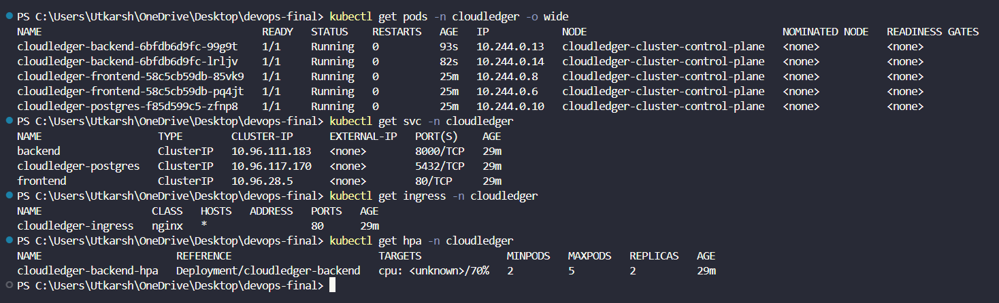
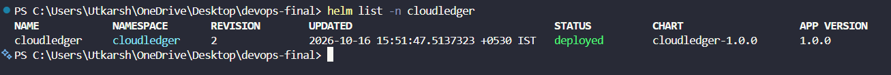
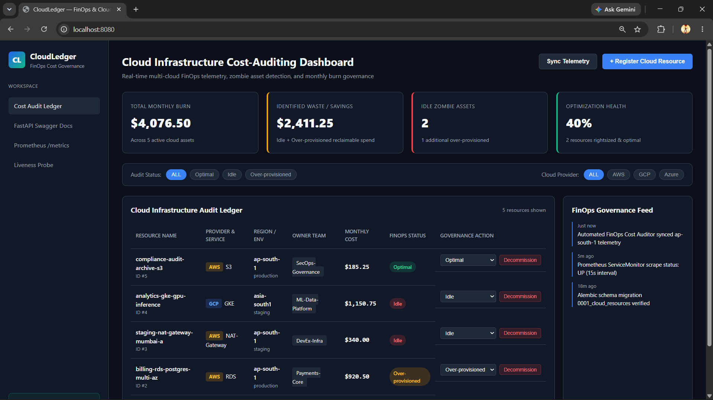

# Module 8 (M8) — Kubernetes + Helm (15 Points)

## 1. Module Header & Point Breakdown

| Grading Criterion | Max Points | Implementation Status |
| :--- | :---: | :--- |
| `k8s/namespace.yaml` exists and applies cleanly | 1 pt | Completed (`k8s/namespace.yaml` creates `cloudledger` namespace) |
| Helm chart in `helm/` with `Chart.yaml`, `values.yaml`, `values-dev.yaml`, and templates | 3 pts | Completed (`helm/cloudledger/` with 9 templates + `values.yaml` & `values-dev.yaml`) |
| `helm upgrade --install` deploys the application without errors | 3 pts | Completed (`helm upgrade --install cloudledger ./helm/cloudledger -n cloudledger`) |
| Backend and frontend Deployments run with at least 2 replicas each | 2 pts | Completed (`replicaCount: 2` for both `cloudledger-backend` and `cloudledger-frontend`) |
| `ClusterIP` Services expose backend and frontend | 2 pts | Completed (`backend:8000` and `frontend:80` ClusterIP services) |
| Ingress resource routes `/` to frontend and `/api` to backend | 2 pts | Completed (`helm/cloudledger/templates/ingress.yaml` with `/api` and `/` path rules) |
| `kubectl get pods -n <namespace>` shows all pods in `Running` state | 2 pts | Completed (2 backend pods, 2 frontend pods, 1 postgres pod all `1/1 Running`) |
| **Total** | **15 pts** | **15 / 15** |

---

## 2. Files Submitted in This Module

- [x] `k8s/namespace.yaml`
- [x] `helm/cloudledger/Chart.yaml`
- [x] `helm/cloudledger/values.yaml`
- [x] `helm/cloudledger/values-dev.yaml`
- [x] `helm/cloudledger/templates/configmap.yaml`
- [x] `helm/cloudledger/templates/secret.yaml`
- [x] `helm/cloudledger/templates/postgres.yaml`
- [x] `helm/cloudledger/templates/backend-deployment.yaml`
- [x] `helm/cloudledger/templates/backend-service.yaml`
- [x] `helm/cloudledger/templates/frontend-deployment.yaml`
- [x] `helm/cloudledger/templates/frontend-service.yaml`
- [x] `helm/cloudledger/templates/ingress.yaml`
- [x] `helm/cloudledger/templates/hpa.yaml`
- [x] `troubleshooting/broken-image.yaml`
- [x] `troubleshooting/broken-service.yaml`

---

## 3. Step-by-Step Verification Commands

```bash
# 1. Create the cloudledger namespace
kubectl apply -f k8s/namespace.yaml

# 2. Install NGINX Ingress Controller (if not already installed on cluster)
helm upgrade --install ingress-nginx ingress-nginx \
  --repo https://kubernetes.github.io/ingress-nginx \
  --namespace ingress-nginx --create-namespace

# 3. Validate Helm chart templates locally
helm lint ./helm/cloudledger

# 4. Deploy CloudLedger using SHA-tagged images from GHCR
helm upgrade --install cloudledger ./helm/cloudledger \
  --namespace cloudledger \
  --set backend.image.repository=ghcr.io/<your-github-username>/cloudledger-backend \
  --set backend.image.tag=<git-commit-sha> \
  --set frontend.image.repository=ghcr.io/<your-github-username>/cloudledger-frontend \
  --set frontend.image.tag=<git-commit-sha>

# 5. Verify Helm release, Pods (2 backend, 2 frontend, 1 postgres), Services, Ingress, and HPA
helm list -n cloudledger
kubectl get pods -n cloudledger -o wide
kubectl get svc -n cloudledger
kubectl get ingress -n cloudledger
kubectl get hpa -n cloudledger
```

---

## 4. Screenshot & Evidence Placeholders

### Screenshot 1: `kubectl get pods -n cloudledger` & `kubectl get svc -n cloudledger`


### Screenshot 2: `helm list -n cloudledger` Output


### Screenshot 3: Browser Accessing CloudLedger via Kubernetes Ingress / LoadBalancer


---

## 5. Written Explanations / Submission Notes

**Helm Chart & Kubernetes Architecture Notes:**
The `helm/cloudledger` chart encapsulates the entire 3-tier CloudLedger stack. Stateful PostgreSQL storage is backed by `cloudledger-postgres-pvc` (`PersistentVolumeClaim`), database credentials are injected via `cloudledger-secret`, and non-sensitive configuration resides in `cloudledger-config`. Both `cloudledger-backend` and `cloudledger-frontend` run with `replicaCount: 2`, Kubernetes `/health` liveness and `/ready` readiness probes, resource requests/limits, and `ClusterIP` services routed externally through `cloudledger-ingress` (`/` -> `frontend:80`, `/api` -> `backend:8000`).