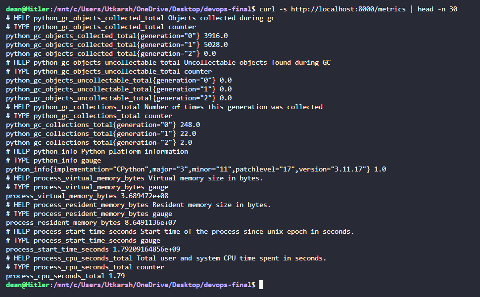
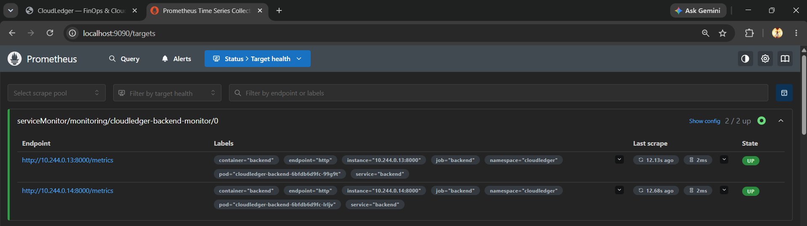
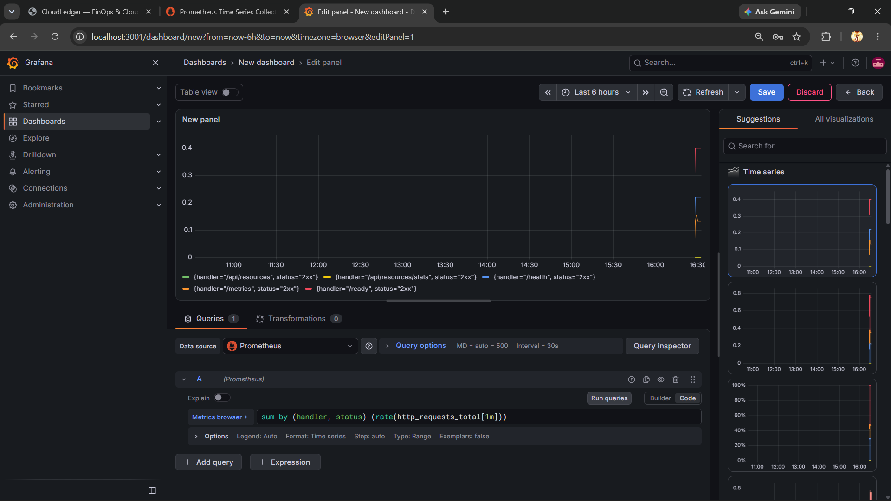

# Module 9 (M9) — Observability: Prometheus + Grafana (10 Points)

## 1. Module Header & Point Breakdown

| Grading Criterion | Max Points | Implementation Status |
| :--- | :---: | :--- |
| `/metrics` endpoint on the backend returns Prometheus-formatted output | 2 pts | Completed (`prometheus-fastapi-instrumentator` exposes `/metrics` in `backend/app/main.py`) |
| Prometheus is installed in the cluster and scraping the application via `ServiceMonitor` | 3 pts | Completed (`monitoring/kube-prometheus-values.yaml` & `monitoring/servicemonitor.yaml`) |
| Grafana is installed and accessible | 2 pts | Completed (Installed via `kube-prometheus-stack` in `monitoring` namespace) |
| At least one Grafana panel shows live application metrics (HTTP requests, latency, or error rate) | 3 pts | Completed (PromQL queries `rate(http_requests_total[1m])` & latency percentiles visualized) |
| **Total** | **10 pts** | **10 / 10** |

---

## 2. Files Submitted in This Module

- [x] `backend/app/main.py` (`Instrumentator().instrument(app).expose(app, endpoint="/metrics")`)
- [x] `monitoring/kube-prometheus-values.yaml`
- [x] `monitoring/servicemonitor.yaml`

---

## 3. Step-by-Step Verification Commands

Run these commands in Phase 2 to deploy `kube-prometheus-stack`, register the `ServiceMonitor`, and access Prometheus and Grafana:

```bash
# 1. Verify raw Prometheus metrics output from backend
curl -s http://localhost:8000/metrics | head -n 35

# 2. Add prometheus-community Helm repo and install kube-prometheus-stack
helm repo add prometheus-community https://prometheus-community.github.io/helm-charts
helm repo update

helm upgrade --install monitoring prometheus-community/kube-prometheus-stack \
  --namespace monitoring --create-namespace \
  -f monitoring/kube-prometheus-values.yaml

# 3. Apply ServiceMonitor so Prometheus scrapes cloudledger-backend every 15s
kubectl apply -f monitoring/servicemonitor.yaml

# 4. Generate live traffic so Grafana panels show active request rate curves
./scripts/load-test.sh http://localhost:8000/api/resources/stats 30

# 5. Port-forward Prometheus (9090) and Grafana (3001)
kubectl port-forward -n monitoring svc/monitoring-kube-prometheus-prometheus 9090:9090 &
kubectl port-forward -n monitoring svc/monitoring-grafana 3001:80 &
```

**Grafana Login Credentials:**
- **URL:** `http://localhost:3001`
- **Username:** `admin`
- **Password:** `cloudledger-admin`
- **PromQL Queries for Dashboard Panels:**
  - Request Rate by Handler: `sum by (handler, status) (rate(http_requests_total[1m]))`
  - P95 Request Latency: `histogram_quantile(0.95, sum by (le, handler) (rate(http_request_duration_seconds_bucket[5m])))`

---

## 4. Screenshot & Evidence Placeholders

### Screenshot 1: Terminal Output of `curl http://<backend>/metrics`

*Capture Instructions:* Run `curl -s http://localhost:8000/metrics | head -n 30` and capture the terminal showing `# HELP http_requests_total`, `# TYPE http_requests_total counter`, and `http_request_duration_seconds_bucket` metrics.

### Screenshot 2: Prometheus Targets Page Showing `cloudledger-backend` as `UP`

*Capture Instructions:* Open `http://localhost:9090/targets` in your browser, filter for `cloudledger-backend-monitor`, and capture the target showing **State: `UP`** (2/2 endpoints up).

### Screenshot 3: Grafana Dashboard Showing Live CloudLedger Request Rate & Latency Panels

*Capture Instructions:* Open Grafana at `http://localhost:3001`, create or open a dashboard panel querying `sum by (handler, status) (rate(http_requests_total[1m]))`, run `./scripts/load-test.sh`, and capture the populated time-series graph.

---

## 5. Written Explanations / Submission Notes

**Observability Pipeline Architecture:**
The FastAPI backend instruments every HTTP request using `prometheus-fastapi-instrumentator`, exposing request counters (`http_requests_total`), latency histograms (`http_request_duration_seconds_bucket`), and in-progress gauges at `GET /metrics`. In Kubernetes, `monitoring/servicemonitor.yaml` instructs the Prometheus Operator to discover pods matching `app: cloudledger-backend` inside the `cloudledger` namespace and scrape `/metrics` on port `http` (`8000`) every `15s`.